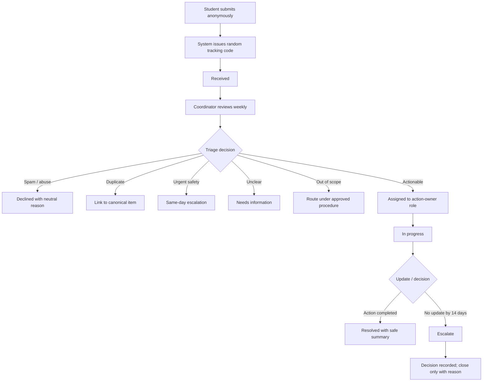

# Task 1 — Improving the college suggestion-box workflow

**Proposed change:** replace the once-a-month physical suggestion-box review with an anonymous online intake and a weekly triage process. Prefer adding a “Student suggestion” category to an existing college feedback portal if the college confirms that it can support anonymous submissions and tracking.

## Evidence status — read before using this report

This report is complete as an **analysis and design proposal**. The user reports that verbal permission was given and that the campus-level observation is that suggestions can take a long time to implement. The person's name/role, exact date and permission scope were not supplied, so they are not invented. The delay observation is qualitative, not a timed measurement. Therefore:
- the physical box and monthly review cadence are user-supplied information, not independently verified here;
- process details beyond that description are labelled assumptions;
- all time and volume figures are illustrative estimates;
- all five tests are synthetic paper walkthroughs, not software tests.

Do not present an assumption as a fact. If you obtain permission and conduct a brief observation or interview, update `evidence-log.md` and revise the model inputs before submitting.

## Files

| File | Purpose |
|---|---|
| `process-map.md` | Current-state map, roles, handoffs, approvals and exceptions |
| `problem-and-scale.md` | Operational problem, estimated scale and baseline |
| `improved-process.md` | Proposed workflow, input fields, statuses, owner, approvals, fallback and risks |
| `test-cases.md` | Five synthetic cases and expected recovery behaviour |
| `calculations.md` | Staff-time and student-time calculations, scenario analysis and limitations |
| `calc.py` | Reproducible calculation model |
| `calc-output.txt` | Output generated by `calc.py` |
| `evidence-log.md` | Evidence classification and what remains unverified |
| `fieldwork-checklist.md` | Ethical fieldwork steps if permission is available |
| `personal-contribution.md` | Honest contribution and AI-use disclosure |

## Executive summary

The current process is described as a physical suggestion box in the college building that is checked around once a month. The reported campus observation is that suggestions can take a long time to implement; the actual causes and elapsed times have not been measured. A monthly review cycle would create an estimated average wait of 15 days and a worst-case wait of 30 days before first review, assuming submissions arrive evenly throughout the cycle. A weekly review would reduce those estimates to 3.5 days and 7 days.

The proposed workflow gives each submission a random tracking code, a status, a responsible role and a clear escalation route. Urgent safety concerns are routed the same day. A deputy covers absences, and the physical box remains a fallback if the online service fails.

The illustrative model uses 20, 40, 80 and 160 submissions per month because the real volume is unknown. At 40 submissions/month, the assumptions produce 195 staff minutes/month for the current process, 270 minutes for a new tool, and 250 minutes for adding the process to an existing portal. In other words, the proposal does **not** save staff time at this volume under the current assumptions. Its clearest benefits are faster review, status visibility, duplicate counting and a feedback loop. Reusing an existing portal is the more proportionate option if it can meet privacy and tracking requirements.

## Recommendation

1. Confirm the actual process and permission status before claiming fieldwork.
2. Ask the college whether the existing anonymous feedback portal can safely support student suggestions and tracking.
3. Pilot the weekly process for four to six weeks with a named coordinator and deputy.
4. Measure actual volume, handling time, time to first review, time to assignment, closure time and duplicate rate.
5. Continue only if the measured benefits justify the extra review and support effort.

## Limitations

- No live system has been built or connected to college systems.
- Verbal permission is reported by the user; the permission giver and exact scope are not recorded. The campus observation about slow implementation is qualitative, not a measured time study. No staff interview results are claimed.
- The volume and handling-time inputs are assumptions.
- The tests are design walkthroughs, not executed software tests.
- Anonymous tracking requires careful configuration; a form alone does not guarantee anonymity.

---

## Supporting detail: Problem and scale

# Problem and scale

## Problem statement

The described process relies on a physical suggestion box that is checked around once a month. The campus-level observation reported for this assignment is that suggestions take a long time to implement. This is a qualitative observation: no specific elapsed times, sample size, or root cause has been measured. A monthly review cycle may contribute to delay before first review, while approval and handoff steps may contribute to delay after review. A proposed online form could make submission easier, make review cadence explicit and provide a tracking code—but it will only improve implementation time if routing, decision ownership and follow-up are also improved.

## What is known versus inferred

- **User-supplied:** a physical suggestion box is used, and it is checked around month-end.
- **User-reported campus observation:** suggestions take a long time to implement. This is not a timed measurement and does not identify the cause.
- **Calculated estimate:** with a 30-day cycle and evenly timed submissions, the expected wait to first review is 15 days and the maximum is 30 days.
- **Proposed improvement:** weekly review would reduce the expected wait to 3.5 days and the maximum to 7 days, assuming the schedule is followed.
- **Not verified:** actual monthly volume, who owns the process, what happens to slips, whether students receive replies, and whether the existing online portal can be reused.

## Estimated scale

Actual monthly volume is unknown, so the model uses scenarios of 20, 40, 80 and 160 submissions per month. These are not measured counts.

At the 40-submission scenario, the assumed current staff effort is:

- Collection/opening: 15 minutes per month.
- Reading/logging: 40 × 1.5 = 60 minutes per month.
- Routing: 20 actionable submissions × 6 minutes = 120 minutes per month.
- **Total: 195 minutes/month, or 3.25 hours/month.**

This is a scenario calculation, not a measurement of staff workload. The 50% actionable share and per-item times are assumptions. The model intentionally varies volume to show how strongly the result depends on real demand.

## How to measure during a pilot

For four to six weeks, record only aggregate operational measures:
- number of submissions received;
- number marked actionable, duplicate, unusable or out of scope;
- minutes spent on triage, routing, updates and support;
- time from submission to first review and assignment;
- time to resolution or closure;
- number of overdue items and escalations.

---

## Supporting detail: Proposed process

# Improved process: anonymous intake with weekly review

## Recommendation

Prefer **Option B: reuse the existing anonymous feedback portal** if the college confirms that it can support student suggestions, anonymous access, role-based staff access and a safe tracking method. If it cannot, pilot Option A (a small new tool) only after privacy, security, ownership and support have been approved.

Online intake alone does not make a process faster. A named accountable role and a dependable review schedule are necessary.

## Inputs

Required:
- category: academics, facilities, safety, transport, food, administration or other;
- suggestion text, with a reminder not to include names or sensitive personal details.

Optional:
- urgency flag, with a notice that the form is not an emergency reporting channel;
- broad location/area where useful, without personal identifiers.

The system should not require a name, student ID or login. The college must confirm how logs, IP addresses, analytics and spam protection are configured before calling the process anonymous. Give the submitter a random tracking code; do not publish the text of suggestions or expose other submissions through a public tracking page. A safer design is a private status lookup using the code, with limited status text.

## Status lifecycle

`Received → Triaged → Assigned → In progress → Resolved`

Alternative statuses:
- **Needs information:** ask a neutral question through the code-based status page; do not request identity.
- **Duplicate:** link to a canonical item and increment its aggregate count.
- **Out of scope:** explain the category of office/body to contact; forward only under an approved procedure.
- **Declined:** record a neutral reason, such as spam or insufficient information.
- **Escalated:** send to a higher responsible role.
- **Closed — no action:** use only with a reason and after the escalation/closure policy has been followed.

## Roles and ownership

- **Accountable owner:** a college-designated Suggestion Coordinator. This is a proposed role, not a claim that the college has appointed someone.
- **Deputy:** covers absence and missed reviews.
- **Action owner:** the relevant department/office role responsible for considering or implementing the suggestion.
- **Approver:** head of department, dean or other authorised role according to college policy.

Every open item must have a status, a responsible role and a next review date. Avoid assigning individual staff names in the public tracking view.

## Review cadence and service targets

1. Review the queue at least once every seven days.
2. Route urgent safety concerns to the responsible safety/welfare role the same day; the form must clearly state that it is not for emergencies.
3. Assign ordinary actionable suggestions within seven days of submission where possible.
4. If no action owner update is received within 14 days after assignment, escalate to the coordinator's supervisor.
5. At day 30, close the item only with a visible neutral reason, or retain it as open if policy requires ongoing review.
6. Publish periodic aggregate “you raised / we reviewed / action taken” summaries only when they do not reveal personal or sensitive details.

These are proposed service targets and must be approved by the college before implementation.

## Approval boundaries

| Coordinator may do | Requires an authorised decision-maker |
|---|---|
| Categorise, merge clear duplicates, route submissions, ask a neutral clarification question, update status | Changes to academic rules, examinations, timetables, fees or policy |
| Mark obvious spam/abuse as declined under a written moderation rule | Spending, procurement, facilities work or staffing changes |
| Escalate urgent items to the responsible role | Complaints about a named person or allegations requiring formal grievance/welfare procedures |
| Publish aggregate counts and generic outcomes | Any disclosure of private information or access to identifying logs |

The coordinator should not investigate allegations about individuals or promise outcomes outside their authority.

## Failure handling

- **Online service unavailable:** keep the physical box as a fallback and arrange a weekly collection by an authorised role. Do not leave submissions unattended until service returns.
- **Coordinator absent:** deputy takes over the queue and the next scheduled review.
- **Backlog or missed review:** alert the deputy after a missed review; escalate to the supervisor if the backlog remains unresolved.
- **No action from an office:** escalate at 14 days; document the decision or reason for no action.
- **Possible safety concern:** follow the college's established safety/welfare escalation process the same day.
- **Tracking code lost:** explain that anonymous recovery may not be possible; do not try to identify the student.
- **Duplicate incorrectly merged:** allow the coordinator to split the item and correct the associated status records.

## Risks and mitigations

| Risk | Mitigation |
|---|---|
| Staff time increases at low submission volume | Reuse existing portal; measure workload during pilot; keep review meetings short |
| “Anonymous” form still records identifying metadata | Obtain IT/privacy review; minimise retention; document actual logging settings |
| Tracking code is guessed or exposed | Use sufficiently random codes; rate-limit lookups; never show other submissions |
| Abuse/spam | Written moderation criteria, rate limits and human review |
| Duplicate suggestions are merged incorrectly | Human review and ability to split items |
| Sensitive complaint is sent through the wrong route | Clear warning and approved grievance/welfare referral process |
| Coordinator absence | Named deputy role and queue handover |
| Online service outage | Physical box checked weekly until service returns |

## Pilot success criteria

After four to six weeks, compare the pilot with the baseline where reliable baseline data exists:
- at least 90% of submissions receive first review within seven days;
- all urgent/safety-flagged submissions are routed the same day under the approved procedure;
- every open item has a status and responsible role;
- aggregate staff minutes per month are measured, not guessed;
- no sensitive submission text is exposed on a public page.

These are proposed targets, not results already achieved.

---

## Before starting

Ask the appropriate staff member for permission. Suggested wording:

> I am completing a college assignment about how the suggestion-box process works. May I observe the box from the outside and ask a few general questions about how it is handled? I will not open the box, read submissions, or record names or private information.

If permission is declined or the requested activity is outside the permission scope, stop. Record only the permission status without identifying the person.

## Observe without opening the box

Record the actual date and time:
1. General location of the box.
2. Whether it appears locked.
3. Whether instructions, paper and a pen are provided.
4. Whether a last-collection date or response notice is visible.
5. Whether it appears empty, partly full or nearly full.
6. Whether a public “you said, we did” notice or other response channel is visible.

Do not photograph people, open the box, read slips or infer contents from handwriting.

## Ask a responsible staff role, if they agree

1. Which role checks the box, and how often?
2. What normally happens after slips are collected?
3. Which role decides what can be actioned, and what needs approval?
4. Is there a rough monthly submission range that can be shared?
5. Do students receive any general response or update?
6. Could the existing anonymous online feedback portal support student suggestions, and what privacy constraints apply?

## How to record it

Add a row to `evidence-log.md`. Use **OBSERVED** only for something directly seen and **TOLD** only for something a person actually said. Use role descriptions, not names. Update the calculations only if you obtain a defensible replacement for an assumption.

---

## Evidence status — read before using this report

This report is complete as an **analysis and design proposal**. The campus-level observation is that suggestions can take a long time to implement. The delay observation is qualitative, not a timed measurement. Therefore:
- the physical box and monthly review cadence are user-supplied information, not independently verified here;
- process details beyond that description are labelled assumptions;
- all time and volume figures are illustrative estimates;
- all five tests are synthetic paper walkthroughs, not software tests.

## Files

| File | Purpose |
|---|---|
| `process-map.md` | Current-state map, roles, handoffs, approvals and exceptions |
| `problem-and-scale.md` | Operational problem, estimated scale and baseline |
| `improved-process.md` | Proposed workflow, input fields, statuses, owner, approvals, fallback and risks |
| `test-cases.md` | Five synthetic cases and expected recovery behaviour |
| `calculations.md` | Staff-time and student-time calculations, scenario analysis and limitations |
| `calc.py` | Reproducible calculation model |
| `calc-output.txt` | Output generated by `calc.py` |
| `evidence-log.md` | Evidence classification and what remains unverified |
| `fieldwork-checklist.md` | Ethical fieldwork steps if permission is available |
| `personal-contribution.md` | Honest contribution and AI-use disclosure |

## Executive summary

The current process is s a physical suggestion box in the college building that is checked around once a month. The reported campus observation is that suggestions can take a long time to implement; the actual causes and elapsed times have not been measured. A monthly review cycle would create an estimated average wait of 15 days and a worst-case wait of 30 days before first review, assuming submissions arrive evenly throughout the cycle. A weekly review would reduce those estimates to 3.5 days and 7 days.

The proposed workflow gives each submission a random tracking code, a status, a responsible role and a clear escalation route. Urgent safety concerns are routed the same day. A deputy covers absences, and the physical box remains a fallback if the online service fails.

The illustrative model uses 20, 40, 80 and 160 submissions per month because the real volume is unknown. At 40 submissions/month, the assumptions produce 195 staff minutes/month for the current process, 270 minutes for a new tool, and 250 minutes for adding the process to an existing portal. In other words, the proposal does **not** save staff time at this volume under the current assumptions. Its clearest benefits are faster review, status visibility, duplicate counting and a feedback loop. Reusing an existing portal is the more proportionate option if it can meet privacy and tracking requirements.

## Recommendation

1. Confirm the actual process and permission status before claiming fieldwork.
2. Ask the college whether the existing anonymous feedback portal can safely support student suggestions and tracking.
3. Pilot the weekly process for four to six weeks with a named coordinator and deputy.
4. Measure actual volume, handling time, time to first review, time to assignment, closure time and duplicate rate.
5. Continue only if the measured benefits justify the extra review and support effort.

## Limitations

- No live system has been built or connected to college systems.
- Verbal permission is reported by the user; the permission giver and exact scope are not recorded. The campus observation about slow implementation is qualitative, not a measured time study. No staff interview results are claimed.
- The volume and handling-time inputs are assumptions.
- The tests are design walkthroughs, not executed software tests.
- Anonymous tracking requires careful configuration; a form alone does not guarantee anonymity.
