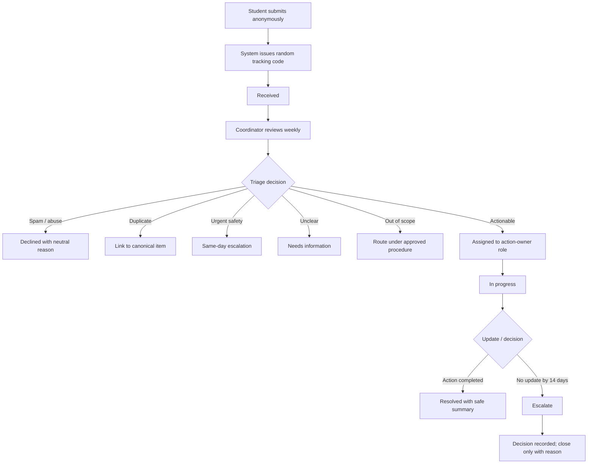

# Improved process: anonymous intake with weekly review

## Recommendation

Prefer **Option B: reuse the existing anonymous feedback portal** if the college confirms that it can support student suggestions, anonymous access, role-based staff access and a safe tracking method. If it cannot, pilot Option A (a small new tool) only after privacy, security, ownership and support have been approved.

Online intake alone does not make a process faster. A named accountable role and a dependable review schedule are necessary.

## Inputs

Required:
- category: academics, facilities, safety, transport, food, administration or other;
- suggestion text, with a reminder not to include names or sensitive personal details.

Optional:
- urgency flag, with a notice that the form is not an emergency reporting channel;
- broad location/area where useful, without personal identifiers.

The system should not require a name, student ID or login. The college must confirm how logs, IP addresses, analytics and spam protection are configured before calling the process anonymous. Give the submitter a random tracking code; do not publish the text of suggestions or expose other submissions through a public tracking page. A safer design is a private status lookup using the code, with limited status text.

## Status lifecycle

`Received → Triaged → Assigned → In progress → Resolved`

Alternative statuses:
- **Needs information:** ask a neutral question through the code-based status page; do not request identity.
- **Duplicate:** link to a canonical item and increment its aggregate count.
- **Out of scope:** explain the category of office/body to contact; forward only under an approved procedure.
- **Declined:** record a neutral reason, such as spam or insufficient information.
- **Escalated:** send to a higher responsible role.
- **Closed — no action:** use only with a reason and after the escalation/closure policy has been followed.

## Roles and ownership

- **Accountable owner:** a college-designated Suggestion Coordinator. This is a proposed role, not a claim that the college has appointed someone.
- **Deputy:** covers absence and missed reviews.
- **Action owner:** the relevant department/office role responsible for considering or implementing the suggestion.
- **Approver:** head of department, dean or other authorised role according to college policy.

Every open item must have a status, a responsible role and a next review date. Avoid assigning individual staff names in the public tracking view.

## Review cadence and service targets

1. Review the queue at least once every seven days.
2. Route urgent safety concerns to the responsible safety/welfare role the same day; the form must clearly state that it is not for emergencies.
3. Assign ordinary actionable suggestions within seven days of submission where possible.
4. If no action owner update is received within 14 days after assignment, escalate to the coordinator's supervisor.
5. At day 30, close the item only with a visible neutral reason, or retain it as open if policy requires ongoing review.
6. Publish periodic aggregate “you raised / we reviewed / action taken” summaries only when they do not reveal personal or sensitive details.

These are proposed service targets and must be approved by the college before implementation.

## Approval boundaries

| Coordinator may do | Requires an authorised decision-maker |
|---|---|
| Categorise, merge clear duplicates, route submissions, ask a neutral clarification question, update status | Changes to academic rules, examinations, timetables, fees or policy |
| Mark obvious spam/abuse as declined under a written moderation rule | Spending, procurement, facilities work or staffing changes |
| Escalate urgent items to the responsible role | Complaints about a named person or allegations requiring formal grievance/welfare procedures |
| Publish aggregate counts and generic outcomes | Any disclosure of private information or access to identifying logs |

The coordinator should not investigate allegations about individuals or promise outcomes outside their authority.

## Failure handling

- **Online service unavailable:** keep the physical box as a fallback and arrange a weekly collection by an authorised role. Do not leave submissions unattended until service returns.
- **Coordinator absent:** deputy takes over the queue and the next scheduled review.
- **Backlog or missed review:** alert the deputy after a missed review; escalate to the supervisor if the backlog remains unresolved.
- **No action from an office:** escalate at 14 days; document the decision or reason for no action.
- **Possible safety concern:** follow the college's established safety/welfare escalation process the same day.
- **Tracking code lost:** explain that anonymous recovery may not be possible; do not try to identify the student.
- **Duplicate incorrectly merged:** allow the coordinator to split the item and correct the associated status records.

## Risks and mitigations

| Risk | Mitigation |
|---|---|
| Staff time increases at low submission volume | Reuse existing portal; measure workload during pilot; keep review meetings short |
| “Anonymous” form still records identifying metadata | Obtain IT/privacy review; minimise retention; document actual logging settings |
| Tracking code is guessed or exposed | Use sufficiently random codes; rate-limit lookups; never show other submissions |
| Abuse/spam | Written moderation criteria, rate limits and human review |
| Duplicate suggestions are merged incorrectly | Human review and ability to split items |
| Sensitive complaint is sent through the wrong route | Clear warning and approved grievance/welfare referral process |
| Coordinator absence | Named deputy role and queue handover |
| Online service outage | Physical box checked weekly until service returns |

## Pilot success criteria

After four to six weeks, compare the pilot with the baseline where reliable baseline data exists:
- at least 90% of submissions receive first review within seven days;
- all urgent/safety-flagged submissions are routed the same day under the approved procedure;
- every open item has a status and responsible role;
- aggregate staff minutes per month are measured, not guessed;
- no sensitive submission text is exposed on a public page.

These are proposed targets, not results already achieved.
